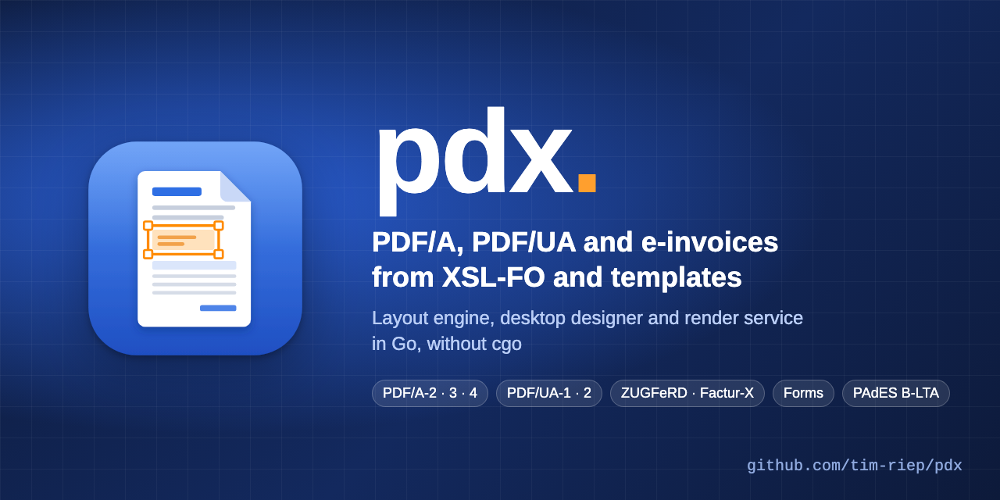

# pdx



pdx creates PDF files from XSL-FO and templates: PDF/A-2, PDF/A-3 and PDF/A-4, accessible PDF/UA-1 and PDF/UA-2, and hybrid e-invoices after ZUGFeRD and Factur-X. It is written entirely in Go without cgo. An XSD describes the data interface, the desktop Designer lays out the document, and the engine typesets it. veraPDF is the reference validator for conformance.

The repository contains:

* the layout engine for business documents (page sequences, tables, lists, keeps, markers, Knuth-Plass line breaking, hyphenation, links, bookmarks, barcodes)
* template format 1 with a compiler to XSLT 3.0 and binding checks against the data XSD
* fillable forms, PAdES signatures up to B-LTA and an HTTP render service
* the desktop Designer (Wails and Svelte) in [`designer/`](designer/README.md), which can rebuild the sample invoice without writing XML

## Installation

Release archives for Linux, macOS and Windows are on the [releases page](https://github.com/tim-riep/pdx/releases), each with `SHA256SUMS`.

* `pdx-<version>-<os>-<arch>` contains the command line tool `pdx` and the render service `pdx-server`. Both are single static binaries, put them anywhere on your `PATH`.
* The Designer comes as a setup program and as an archive with an install script:
  * macOS: `pdx-designer-<version>-darwin-arm64.pkg`, installs per user into `~/Applications` without administrator rights
  * Windows: `pdx-designer-<version>-windows-amd64-setup.exe`, installs per user into `%LOCALAPPDATA%\Programs\pdx` without administrator rights, with a Start menu entry and uninstall through Settings, Apps
  * Linux: `pdx-designer-<version>-linux-amd64.deb` for Debian and Ubuntu, installs system-wide into `/usr/bin` and pulls in GTK 4 and WebKitGTK 6 (`sudo apt install ./pdx-designer-….deb`)
  * `pdx-designer-<version>-<os>` archives contain the Designer and the per-user install script described below
* The render service is also available as a container image: `docker pull ghcr.io/tim-riep/pdx-server:<version>`.

### Where pdx Designer is installed

pdx Designer is installed per user, without administrator rights. The macOS and Windows setup programs and the install script in the archives use the following places, installing again updates the installation. The Debian package is the exception, it installs system-wide as Debian packages do.

| System | Program | Menu entry | Settings and autosaves |
|---|---|---|---|
| macOS | `~/Applications/pdx Designer.app` | Launchpad, Spotlight | `~/Library/Application Support/pdx-designer` |
| Linux | `~/.local/bin/pdx-designer` | `~/.local/share/applications/pdx-designer.desktop` | `~/.config/pdx-designer` |
| Windows | `%LOCALAPPDATA%\Programs\pdx\pdx-designer.exe` | Start menu, pdx Designer | `%APPDATA%\pdx-designer` |

```bash
./install.sh
```

```powershell
powershell -ExecutionPolicy Bypass -File install.ps1
```

`./install.sh --uninstall` or `install.ps1 -Uninstall` removes the program and the menu entry. Settings and autosaves stay in place. On Linux the license files go to `~/.local/share/doc/pdx-designer`, on macOS they are inside the app bundle, on Windows next to the program. `PDX_DESIGNER_DATA` replaces the settings directory, for example for tests.

The Designer needs GTK 4 and WebKitGTK 6 on Linux and the WebView2 runtime on Windows (included in Windows 11, the Windows setup points to it if missing). On macOS the app, the `.pkg` and the command line tools are signed with Developer ID and notarized by Apple. The Windows programs are not signed yet, confirm the SmartScreen notice with More info and Run anyway.

The Designer finds veraPDF on its own, also when started from Finder, Launchpad or the Start menu: it searches the `PATH`, `~/verapdf` (where the veraPDF installer puts it), `/usr/local/bin` and Homebrew, on Windows the user folder and Program Files, and uses Docker otherwise. A different location can be set in the conformance panel (Konformität, veraPDF).

## Usage

```bash
go build -o pdx ./cmd/pdx
```

```bash
pdx render input.fo -o output.pdf --profile pdfa-3b --attach factur-x.xml:Alternative:text/xml --creation-date 2026-01-01T00:00:00Z
```

```bash
pdx verify output.pdf --profile pdfa-3b
```

`render` writes the PDF. Without `--creation-date`, `SOURCE_DATE_EPOCH` applies, otherwise the current time. More options: `--font FILE` (repeatable) registers additional fonts, `--area-tree FILE` writes the area tree as text, `--tagged` writes tagged PDF with a structure tree even when the profile does not require it.

```bash
pdx structure output.pdf
```

`structure` prints the logical structure tree: type, language, alternate text, header cell references and text in reading order for each element. Contradictions between the tree, the ParentTree and the marked content (unmarked content, missing or orphaned MCIDs) are reported as findings and give exit code 1.

With a template (a ZIP package or a directory with `template.xml`), data becomes documents:

```bash
pdx render --template template.zip data.xml -o output.pdf --profile pdfa-3b --strict
```

```bash
pdx check template.zip
```

```bash
pdx compile template.zip -o template.xsl --source-map template.map.json
```

`--strict` validates the data against the data XSD of the package first, `--lang` selects text resources and format patterns, `--fo FILE` also writes the generated FO. `check` reports errors in template, package, translations and bindings with the ID of the template element (`--format json` for the Designer). `pdx fmt -w template.xml` writes the template in canonical form, `pdx pack directory -o template.zip` packs it deterministically.

`verify` validates a file with veraPDF and prints every finding with specification, clause, test number, description and object context (`--format json` for machines). Exit codes: 0 conformant, 1 at least one failed test or an error, 2 usage error.

## Architecture

```
template ──compile──▶ XSLT 3.0 ──go-xslt──▶ XSL-FO      data XSD ──dataschema──▶ findings
(template, template/pkg)   ▲ data                 │
                                                  ▼
XSL-FO ──fo/tree──▶ FO tree ──fo/layout──▶ area tree ──pdf/render──▶ PDF
                     fo/props   fo/linebreak   │           pdf, pdf/profile,
                                font, image,    │           pdf/xmp, icc
                                hyph, barcode   ▼
                                     Designer canvas, raster tests
```

| Package | Purpose |
|---|---|
| `pdx` (root) | facade `Render`, `RenderFile`, `RenderTemplate` and `CompileTemplate` for CLI, Designer and server |
| `cmd/pdx` | command line tool |
| `cmd/pdx-server` | render service |
| `areatree` | stable intermediate format: pages, containers, glyph runs, images, lines in millipoints, origin top left. No dependency on other pdx packages |
| `fo/tree` | FO parser with line and column positions, checks the supported subset |
| `fo/props` | lengths, colors, shorthands, inheritance, margins to indents |
| `fo/linebreak` | box glue penalty model, `Breaker` interface, Knuth-Plass with the parameters of FOP, greedy as fallback |
| `fo/layout` | galley and page breaking, page sequences, tables, lists, keeps, markers, multi-pass references, links, bookmarks, barcodes |
| `hyph` | Liang hyphenation with patterns from hyph-utf8 (de-1996, en-us) |
| `barcode` | QR, GiroCode (EPC069-12), DataMatrix, Code 128 as module grids |
| `template` | template format 1: XSD, parser, canonical writer |
| `template/pkg` | template packages from ZIP or directory, deterministic writing |
| `compile` | template to XSLT 3.0 with carry-overs, formats and source map |
| `dataschema` | static check of bindings against the data XSD |
| `check` | all checks of `pdx check` for CLI and Designer |
| `font` | loading through textshape, shaping, subsetting, Type0 with Identity-H, `/W`, ToUnicode, registry with the Liberation fonts |
| `image` | JPEG passed through, PNG to Flate, separate alpha |
| `pdf` | object model, content streams, xref, trailer, check of the object graph against the policy |
| `pdf/profile` | conformance profiles |
| `pdf/xmp` | XMP with pdfaid and the pdfaExtension schema |
| `pdf/render` | area tree to PDF |
| `pdf/reader`, `pdf/incr` | reading PDF and incremental updates |
| `sign` | CMS, RFC 3161 time stamps and PAdES signatures |
| `server` | HTTP render service |
| `icc` | self-computed sRGB profile (ICC 2.1) for the output intent |
| `verapdf` | calling veraPDF and reading the mrr report |
| `internal/fopcompare` | comparison with Apache FOP 2.11 through Docker: area tree, text positions, pixels |

### Conformance by construction

A profile implements `pdf.Policy` (`Allow(Feature)`) and `Prepare`. Every critical feature (transparency, attachments, LZW, external content, non-embedded fonts) is requested before use. Before writing, the writer also scans the whole object graph. Anything the profile does not allow stops with an error that names the clause of the standard, instead of producing a non-conformant file. pdx never writes JavaScript, XFA or encryption.

### Reproducibility

Fixed object order, sorted dictionary keys, fixed number formatting, an injectable creation date, subset prefixes from hashes and a file ID from the MD5 of the file bytes. The same input and date give byte-identical files (`TestReproducible`).

## Profiles

| Name | Meaning |
|---|---|
| `pdfa-3b` | PDF/A-3b after ISO 19005-3. Output intent GTS_PDFA1 with sRGB, XMP with pdfaid, attachments with AFRelationship, transparency allowed |
| `pdfa-3u` | PDF/A-3u, additionally a Unicode mapping for every glyph (6.2.11.7.2). Without one, writing stops and names the font and glyph |
| `pdfa-2b`, `pdfa-2u` | PDF/A-2 after ISO 19005-2. Attachments only as PDF/A-1 or PDF/A-2 (6.8), all invalid attachments in one message |
| `pdfa-3a` | PDF/A-3a, tagged PDF with a structure tree (6.7). Requires a document language and alternate texts for figures |
| `pdfa-4`, `pdfa-4f` | PDF/A-4 after ISO 19005-4, based on PDF 2.0. Header `%PDF-2.0`, no info dictionary, metadata only in XMP with `pdfaid:rev` 2020. With `pdfa-4` attachments only as PDF/A-1, -2 or -4 (6.9), `pdfa-4f` allows any attachment and requires at least one |
| `pdf-2.0` | PDF 2.0 without a conformance claim, metadata in XMP |
| `pdfua-2` | PDF/UA-2 after ISO 14289-2, based on PDF 2.0, combinable with PDF/A-4, for example `pdfa-4f,pdfua-2`. Structure elements in the PDF 2.0 namespace, footnotes as FENote, internal links and bookmarks with structure destinations, attachments with descriptions, `pdfuaid:rev` 2024 |
| `pdfua-1` | PDF/UA-1 after ISO 14289-1, combinable with PDF/A-2 and PDF/A-3, for example `pdfa-3a,pdfua-1`. XMP with pdfuaid, DisplayDocTitle. Also requires a title, headings starting at H1 without gaps, header cells in tables and links with text in the structure tree |
| `pdf-1.7` | PDF 1.7 without a conformance claim, fonts are still always embedded |

Profiles can be combined, for example `--profile pdfa-3a,pdfua-1`. pdx rejects invalid combinations before rendering, with all reasons: different PDF versions (PDF/A-2, PDF/A-3 and PDF/UA-1 are based on PDF 1.7, PDF/A-4 and PDF/UA-2 on PDF 2.0), or two PDF/A or two PDF/UA parts. `pdx verify` checks every claimed standard with veraPDF in a separate run.

With `pdfa-3a` and `pdfua-1`, pdx checks everything that cannot be filled in automatically before writing and reports all findings at once with the ID of the template element, for example `[girocode] Abbildung ohne Alternativtext (alt oder altBind), ISO 14289-1 7.3, ISO 19005-3 6.7`. Headers and footers are artifacts, `artifact="false"` moves content such as the address and invoice details into the structure tree. Repeated table headers, carry-overs and subtotals are artifacts.

Lists get `ListNumbering` from the text of their labels (digits Decimal, letters LowerAlpha or UpperAlpha, otherwise Disc, or Unordered under PDF 2.0).

## Accessibility

With `pdfa-3a`, `pdfua-1` or `pdfua-2` (or `--tagged`), pdx writes tagged PDF. The structure tree comes from the roles in the template: headings, paragraphs, tables with head, body, foot and header cells with their references, lists with label and body, figures with alternate text, links with annotations. The reading order follows the flow, `readingOrder` orders freely placed elements, otherwise top to bottom and left to right applies.

The template attributes for this are `role`, `alt`, `altBind` (alternate text from the data, for example for the GiroCode), `lang`, `readingOrder`, `artifact` and `scope` on cells. `pdx structure output.pdf` shows the tree with text in reading order.

What no software can decide, for example whether an alternate text is correct, the Designer lists as a checklist after the Matterhorn Protocol 1.1 (PDF Association, CC BY 4.0).

### Quick test with a screen reader

VoiceOver (macOS) with Preview, checked on 18 October 2026 with the sample invoice as `pdfa-3a,pdfua-1`:

1. `pdx render --profile pdfa-3a,pdfua-1 --template testdata/templates/musterrechnung -o rechnung.pdf testdata/templates/musterrechnung/samples/rechnung.xml`
2. Open the file in Preview, turn on VoiceOver with Cmd+F5 and move through the document with Ctrl+Option+Right.
3. Expected: letterhead, sender line, address and invoice details before the heading "Rechnung" (announced as a heading), then the table with rows and cells. Page numbers and repeated table headers are skipped, the GiroCode is announced with its alternate text.

Result: Preview gives VoiceOver the heading, the table as rows and cells and the image with alternate text from the structure tree, in the order of the tree. The same invoice without tags (`pdfa-3b`) has no heading, and Preview guesses the table rows from the layout. Preview does not evaluate everything PDF/UA describes, for example the header cell references. For a complete check use NVDA on Windows with a PDF reader that supports tagged PDF, or the PDF Accessibility Checker (PAC).

NVDA (Windows): open the file, jump from heading to heading with H, to the table with T, and from cell to cell inside the table with Ctrl+Alt+arrow keys. NVDA announces the column headers.

## E-invoices

A template with the element `einvoice` produces hybrid invoices after ZUGFeRD 2 and Factur-X 1.0. The data must be a CII invoice (`rsm:CrossIndustryInvoice`), pdx rejects UBL with a message. The profile level is taken from the data (guideline ID, BT-24): MINIMUM, BASIC WL, BASIC, EN 16931, EXTENDED or XRECHNUNG. pdx embeds the data as `factur-x.xml` (`xrechnung.xml` for XRECHNUNG), with `AFRelationship` Data for MINIMUM and BASIC WL and Alternative otherwise (`afRelationship` on the element overrides this), and writes the XMP schema `fx`. The values are checked against the reference implementation Mustang.

E-invoices require PDF/A-3, that is `pdfa-3b`, `pdfa-3u` or `pdfa-3a,pdfua-1`. pdx rejects other profiles with the ID of the element. pdx does not validate the invoice data against the Schematron rules of EN 16931 and XRechnung. Example: `testdata/templates/cii-rechnung` with data for the levels EN 16931 and XRECHNUNG.

## Forms

Templates can contain fillable fields: `textField` (also multi-line, with `maxLength`), `checkBox`, `radioGroup`, `listBox`, `comboBox` and `signatureField`. Every field is bound to a data path. Options come from the template or from the enumeration in the data XSD, the maximum length from `maxLength` in the template or the XSD facet. pdx writes AcroForm with its own appearance for every widget and an embedded default font (DR). It never writes NeedAppearances, XFA or JavaScript, and no actions on fields. In accessible profiles `label` is required and becomes the accessible name (TU, under PDF/UA-2 also Contents on the widget). Every widget is a Form element in the structure tree, the tab order follows the structure (`/Tabs /S`).

```bash
pdx extract-data form.pdf --template template.zip -o data.xml
```

```bash
pdx flatten form.pdf --template template.zip -o static.pdf --profile pdfa-3a,pdfua-1
```

`extract-data` reads the field values, inserts them into the embedded original data (or into `--data`), adds missing nodes in XSD order and validates the result against the data XSD, with all findings at once. `flatten` renders the document again with this data and draws the fields as fixed content, so conformance by construction is kept. Fillable forms are checked with veraPDF under PDF/A-3a with PDF/UA-1 and under PDF/A-4f with PDF/UA-2.

## Signatures

```bash
PDX_SIGN_PASSWORD=… pdx sign invoice.pdf -o signed.pdf --level B-LTA --signer pkcs12:key.p12 --tsa https://tsa.example.org --field signature
```

`sign` signs a finished PDF after PAdES baseline (ETSI EN 319 142-1), only through an incremental update, so PDF/A conformance and earlier signatures are kept.

* B-B: CMS with SubFilter ETSI.CAdES.detached, signed attributes content-type, message-digest and signing-certificate-v2, time in /M, ByteRange over the whole file except Contents, exactly one SignerInfo with the signing certificate.
* B-T: additionally an RFC 3161 time stamp over the signature value.
* B-LT: additionally a DSS with all certificates up to the root, OCSP responses and CRLs for the signature and the time stamp service, fetched through AIA and CDP.
* B-LTA: additionally a document time stamp (ETSI.RFC3161) and the DSS again.

Without `--field`, pdx adds an invisible signature field. A field from the template shows signer, date, reason and location in the form font after signing, with the same text for assistive technology. Expired and revoked certificates are rejected.

Signers: `pkcs12:file.p12` with the password from `PDX_SIGN_PASSWORD` or a prompt on the terminal without echo, or `remote:https://service` for a signing service with the token from `PDX_SIGN_TOKEN`. The signing service only receives the hash (`GET /certificates`, `POST /sign` with JSON), every response is checked against the certificate before it is used. Passwords and tokens are never command line arguments, keys stay in memory and never appear in any output.

Signatures are validated with the EU DSS validator 6.5.1 (`dssval`, a locally built image from `esig/dss-demonstrations` with version, commit and base images pinned). The tests create their own test PKI with root, intermediate CA, OCSP, CRL and time stamp service, there are no real keys in the repository. All levels give TOTAL_PASSED for the sample invoice in PDF/A-3b and PDF/A-4f, and veraPDF still passes afterwards.

```bash
make dss-image
```

```bash
make dss
```

## Render service

`pdx-server` renders templates over HTTP, using only the Go standard library.

```bash
go build -o pdx-server ./cmd/pdx-server
```

```bash
pdx-server hash-key < key.txt
```

```bash
pdx-server -config pdx-server.json
```

The configuration is JSON. API keys are stored only as SHA-256 hashes with rights per key (`render`, `templates`, `verify`, `sign`), `hash-key` reads the key from standard input.

```json
{
  "addr": ":8080",
  "templateDir": "/var/lib/pdx/templates",
  "maxConcurrent": 8,
  "timeout": "30s",
  "keys": [{"name": "app", "sha256": "…", "rights": ["render"]}],
  "verapdf": "docker",
  "signer": "pkcs12:/etc/pdx-signer/key.p12",
  "tsa": "https://tsa.example.org"
}
```

More limits: `maxBody` (data, 10 MiB), `maxTemplate` (package, 50 MiB), `maxPDF` (verify and sign, 50 MiB), `maxBatch` and `maxBatchEntries` (batch, 100 MiB and 1000 records), `queueWait` (wait for a free slot, 5 s), `batchTimeout` (10 min).

| Endpoint | Right | Purpose |
|---|---|---|
| `POST /v1/render/{id}` | render | data XML to PDF, parameters `version`, `profile`, `lang`, `strict`, `creationDate` |
| `POST /v1/render/{id}/batch` | render | ZIP with XML files to a ZIP with PDFs and `ergebnis.json` |
| `POST /v1/templates/{id}` | templates | template package as a new version, `activate=true` activates it |
| `GET /v1/templates`, `GET /v1/templates/{id}/versions` | templates | templates and versions |
| `GET /v1/templates/{id}/versions/{version}` | templates | package of a version |
| `PUT /v1/templates/{id}/active` | templates | activate a version |
| `POST /v1/verify` | verify | validate a PDF with veraPDF |
| `POST /v1/sign` | sign | sign a PDF after PAdES |
| `GET /healthz`, `GET /readyz`, `GET /metrics`, `GET /openapi.json` | none | operations |

`server/openapi.json` (OpenAPI 3.1) describes the interface, the tests check every response against it. Errors are Problem Details after RFC 9457 with all findings and template IDs, their types are below `https://github.com/tim-riep/pdx/problems/`. Versions are immutable and numbered sequentially, the same content does not create a new version. The store is a directory, also on a shared volume for several instances. Compiled templates are kept in an LRU cache. `/metrics` reports requests and durations per route and status in the Prometheus text format.

The Designer publishes templates directly: enter address and key, compare with the active version (files, and `template.xml` line by line), upload, activate.

### Operations

```bash
make image
```

The image (`deploy/Dockerfile`) is based on distroless static as user nonroot, Go without cgo with `-trimpath`, base images pinned by digest, for linux/amd64 and linux/arm64. Two builds give the same digest. It runs with a read-only file system, the configuration goes to `/etc/pdx/pdx-server.json`, the store to `/var/lib/pdx/templates`. `deploy/k8s` contains a Kubernetes example with a namespace under the restricted Pod Security standard, a ConfigMap, a shared volume (ReadWriteMany), a Deployment without privileges with probes, a Service, a NetworkPolicy, an HPA and a PodDisruptionBudget, tested in a local k3d cluster.

Load test with the load driver `deploy/last` (key from `PDX_KEY`):

```bash
go run ./deploy/last -url http://127.0.0.1:8080 -id rechnung -data testdata/templates/musterrechnung/samples/rechnung.xml -c 8 -d 30s -p95 300ms -rate 30
```

Agreed targets for the sample invoice (three pages, PDF/A-3b) with 8 parallel requests on 4 CPUs: p95 below 300 ms and at least 30 PDFs per second. Measured in a container with 4 CPUs and 1 GiB on an Apple M4 with `GOGC=400` and `GOMEMLIMIT=800MiB` (as in the Deployment): 43 to 85 PDFs per second, p95 135 to 263 ms, depending on other load on the machine. Without these settings 42 to 56 PDFs per second with p95 up to 310 ms. The Mac is not the target environment, measure again on the target system.

### Security and privacy

* No payload data in logs or metrics: logs (JSON through `log/slog`) contain method, route pattern, status, duration, size and the name of the key, never bodies, queries or values from the path.
* Nothing is stored beyond the request except templates. `verify` keeps the PDF in a temporary file only while validating.
* API keys only as hashes, compared in constant time, rights per key. The client and the Designer require HTTPS except for localhost. TLS belongs in front of the service (ingress or proxy).
* The password and token of the signer only come from the environment, are read at startup and removed from it. In the Kubernetes example they come from a Secret.
* Limits for size, concurrency and run time of every request. The XML parser rejects external entities in data.
* Fuzz targets for upload, rendering, signing and reading PDF.

## Supported FO subset

Page layout: `fo:simple-page-master` with all five regions, `fo:page-sequence-master` with `fo:single-page-master-reference`, `fo:repeatable-page-master-reference`, `fo:repeatable-page-master-alternatives` and `fo:conditional-page-master-reference` (`page-position`, `odd-or-even`, `blank-or-not-blank`), `force-page-count`, `initial-page-number`.

Blocks and inlines: `fo:block`, `fo:block-container` (also `absolute-position`), `fo:inline`, `fo:leader`, `fo:basic-link`, `fo:external-graphic`, `fo:instream-foreign-object`, `fo:page-number`, `fo:page-number-citation`, `fo:page-number-citation-last`.

Tables and lists: `fo:table` with fixed layout, proportional columns, repeated header and footer, cells spanning columns and rows, border models `separate` and `collapse` (simplified). `fo:list-block` with `label-end()` and `body-start()`.

Breaking: `keep-together`, `keep-with-next`, `keep-with-previous` with strengths, `break-before`, `break-after`, `widows`, `orphans`. Line breaking with Knuth-Plass, justification with `text-align-last`, hyphenation with `hyphenate`, `language`, `hyphenation-character` and the minimum lengths.

Markers and outlines: `fo:marker`, `fo:retrieve-marker` with all positions and boundaries, `fo:retrieve-table-marker` in table headers and footers, `fo:bookmark-tree`.

Deliberate deviations from Apache FOP are listed with reasons from the specification in `testdata/suites/DEVIATIONS.md`.

### Extensions

Namespace `https://github.com/tim-riep/pdx/ns/fo/1`. Metadata and attachments go into `fo:declarations`, barcodes into `fo:instream-foreign-object`, the place XSL 1.1 provides for foreign content:

```xml
<fo:declarations>
  <pdx:metadata title="Invoice" author="Example Ltd" subject="..." keywords="..." creator="..."/>
  <pdx:attachment src="factur-x.xml" name="factur-x.xml" mime-type="text/xml"
                  relationship="Alternative" description="Invoice data"/>
</fo:declarations>

<fo:instream-foreign-object content-width="30mm">
  <pdx:barcode type="girocode" name="Example Ltd" iban="DE02120300000000202051" amount="1190.00" text="RE-2026-0001"/>
</fo:instream-foreign-object>
```

The FO generated from a template carries `pdx:id` with the ID of the template element on every element. FOP 2.11 skips `fo:declarations`, but does not render barcodes and rejects `pdx:id` without `fop -r` (see DEVIATIONS.md).

## Templates

A template describes the document independently of the data: page masters for first, following and last pages, headers and footers with positioned content, subforms (positioned or flowing, also repeated), texts with embedded fields, tables with header, footer, groups, subtotal (`subtotal`), carry-over (`carryOver`) and total (`total`), barcodes, page numbers ("Seite {current} von {total}"), styles, format patterns per locale and text resources per language. Bindings are XPath expressions against the data XSD. `template/schema/template-v1.xsd` describes the format, names are English in camelCase. The namespace is `https://github.com/tim-riep/pdx/ns/template/1` with `version="1"`. pdx still reads templates in format 0 up to pdx 0.1.0 (namespace `https://pdx.example/ns/template/0`) and upgrades them to format 1 when loading, `pdx fmt -w template.xml` rewrites them permanently. The same applies to the old namespace of the FO extensions.

Design tokens name colors, lengths and fonts in one place (`<tokens>` after `<styles>`). Styles and elements refer to them with `$id`, for example `color="$primaer"`, `padding="$abstand-m 2mm"` or `border="0.5pt solid $linie"`. A font token sets family, size, weight and style through `font="$fliesstext"`, attributes set explicitly on the same element take precedence. Tokens may refer to tokens of the same kind. The compiler resolves the references and reports unknown tokens, wrong kinds and cycles with the template ID.

A package contains `template.xml` and the folders `schema` (data XSD), `assets`, `samples` and `texts`. Example: `testdata/templates/musterrechnung` with 60 line items on three pages, an address window after DIN 5008, carry-over and subtotal per page, a GiroCode and the invoice data as embedded XML (PDF/A-3b).

The compiler produces readable, deterministic XSLT 3.0. Running totals use `xsl:iterate`, carry-overs use markers per table row. A source map translates errors during transformation and typesetting into template IDs.

## Performance

Sample invoice (60 line items, three pages, PDF/A-3b with attachment), Apple M4, Go 1.26:

| Benchmark | Time | Memory |
|---|---|---|
| `BenchmarkCompileInvoice` (template to compiled XSLT) | 1.4 ms | 0.7 MB |
| `BenchmarkRenderInvoice` (transformation, layout, PDF) | 65 ms | 36 MB |
| `BenchmarkParallelRender` with 8 cores, per PDF | 11.5 ms | 35 MB |

```bash
go test -run '^$' -bench Invoice -benchmem .
```

## Fonts

Fonts are always embedded as subsets. `Helvetica`, `Arial` and `sans-serif` map to Liberation Sans, `Times` and `serif` to Liberation Serif, `Courier` and `monospace` to Liberation Mono (embedded in the program, SIL OFL 1.1). If a word lacks a glyph, pdx tries the Liberation fonts as fallback. If none has it, rendering stops with an error, because PDF/A forbids the .notdef glyph.

## veraPDF

Version 1.30.3, configured only in `verapdf`. A local CLI is used when its version matches, searched in the `PATH` and in the usual install folders (`~/verapdf`, `/usr/local/bin`, Homebrew, on Windows the user folder and Program Files), otherwise the Docker image `docker.io/verapdf/cli:v1.30.3` (pinned by digest), with Docker also found outside the `PATH`. ghcr.io only has development builds of 1.31, the release is on Docker Hub. `PDX_VERAPDF=local|docker|<path>` forces a variant.

## Tests

```bash
make test
```

```bash
make conformance
```

```bash
PDX_CONFORMANCE=1 go test ./...
```

* `make test` runs all unit, golden file and reproducibility tests.
* `make conformance` renders the corpus `testdata/fo` and the templates in `testdata/templates` with the CLI and validates every file with veraPDF.
* `make fo-conformance` typesets the FO test suites (selected cases from Apache FOP 2.11 and the W3C XSL test suite, which is downloaded on the first run) and compares them with expectations from FOP. Report per category in `out/fo-conformance.md`, disabled cases with reasons in `testdata/suites/disabled.txt`, known and open deviations in `testdata/suites/deviating.txt`. `make fo-reference` regenerates the expectations (Docker).
* `make fop-compare` compares the corpus and the sample invoice with Apache FOP 2.11 (Docker, `PDX_FOP=1`). Tolerance: positions 1 pt, at most 0.5 % differing pixels per page at 72 dpi.
* With `PDX_CONFORMANCE=1` the Go tests also call veraPDF.
* `make golden` rewrites golden files after a deliberate change (`UPDATE_GOLDEN=1`).
* `make fuzz` runs the fuzz targets `FuzzParse` (FO parser), `FuzzLoad` (fonts), `FuzzTemplateParse` (templates), `FuzzCompile` (compiler), `FuzzExtractData` (reading forms), `FuzzSignPDF` (signing arbitrary files), `FuzzUpload` and `FuzzRender` (render service).
* `make dss` validates all PAdES levels with the EU DSS validator (`PDX_DSS=1`, image from `make dss-image`).
* `make image` builds the pdx-server image twice and compares the digests.

## License

pdx is licensed under the Apache License 2.0, see `LICENSE` and `NOTICE`. `THIRD_PARTY_NOTICES.txt` contains the full license texts of all third-party components included in `pdx` and `pdx-server`: the embedded Liberation fonts (SIL Open Font License 1.1), the hyphenation patterns from hyph-utf8 (MIT, and free redistribution with notice), the Go runtime and all linked Go modules.

```bash
pdx licenses --list
```

`pdx licenses` and `pdx-server licenses` print all texts, the image puts them in `/usr/share/doc/pdx/`. The Designer shows them through its Lizenzen (licenses) button, including Wails and the npm packages of the frontend. `make notices` regenerates the file after a change of dependencies, a test reports an outdated file. Test cases from Apache FOP (Apache License 2.0) and the Source Serif 4 font (SIL Open Font License 1.1) are only in the repository for tests, see `NOTICE`. pdx computes the sRGB profile itself.
